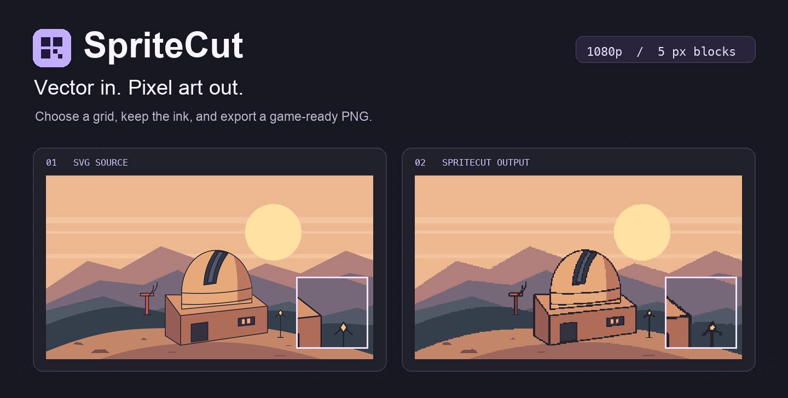

# SpriteCut

[简体中文](docs/README.zh-CN.md)



SpriteCut turns vector illustrations into pixel art for game cutscenes, backgrounds, and sprites. Open an SVG, pick how big the blocks should look, and export a PNG at the resolution your game needs. The preview lets you compare the result with your original before exporting.

The default preset takes a 4K SVG down to **1920 × 1080**, using **5 × 5 px** blocks. That gives you a **384 × 216** pixel grid inside a 1080p image. The adaptive sampler keeps flat fills and looks for thin, dark lines that might disappear with a single center sample.

## Try it locally

With [Node.js](https://nodejs.org/) 20 or later installed, run this from the project folder.

```sh
npm start
```

Open **http://127.0.0.1:4173**. The project has no package dependencies. Use **Try example** to load the desert observatory, or drop in your own SVG, PNG, JPEG, or WebP. Image processing runs in your browser and your files stay on your device.

1. Pick a size preset or set an exact width and height. Choose **Fit entire image**, **Fill and crop**, or **Stretch**.
2. Set the pixel size and use **Compare** to check the edges. Use **Silhouette** for outer lines or **Off** to keep only lines already in the original.
3. Export **PNG** for crisp, lossless color and optional transparency. **JPEG** and **WebP** are available when your browser supports those encoders.

If the source uses externally linked images, embed them in the SVG before importing. For transparent output, the input needs transparent regions. The **Keep transparency** setting preserves them.

## Sampling methods

| Method | When to use it |
| --- | --- |
| Adaptive · Color and ink | Flat-color illustrations and drawings with fine ink lines |
| Nearest neighbor | Art that is already aligned to a pixel grid |
| Area average | Gradients or imagery where each block should reflect all the colors it covers |
| Lanczos 3 | Photos and textured images that need a sharper downsample |

## Project layout

| Path | Role |
| --- | --- |
| `index.html` and `src/styles.css` | Responsive editor and accessible controls |
| `src/app.js` and `src/i18n.js` | Image loading, preview, export, and English/Chinese labels |
| `src/pixel-engine.js`, `src/geometry.js`, and `src/worker.js` | Sampling, outlines, layout, and background conversion |
| `assets/` | Original demonstration SVG and app icon |
| `tests/` | Automated checks for grid placement, color, transparency, and outlines |

Run the checks with `npm test`.

Created by [XuanLIN0224](https://github.com/XuanLIN0224).
