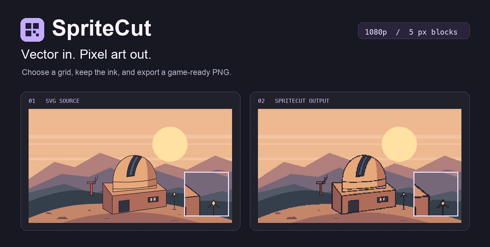

# SpriteCut 像素画转换器

[English](../README.md)

SpriteCut 可以把矢量插画转成适合游戏过场、背景和精灵图使用的像素画。拖进 SVG，选好每一格有多大，预览之后就能导出游戏所需尺寸的 PNG。

默认设置是 **1920 × 1080、16:9、每格 5 × 5 像素**。也就是说，先把画面转换成 **384 × 216 格**，再把每格放大成实心色块。自适应算法会尽量保留大片纯色，以及缩小后容易消失的细黑线。

## 怎么用

安装 Node.js 20 或更新版，在项目目录运行 `npm start`，然后打开 **http://127.0.0.1:4173**。点 **打开示例** 体验沙漠天文台，也可以直接拖入 SVG、PNG、JPEG 或 WebP。图片和转换过程都留在你的设备上。

1. **画幅**可以选 1080p、4K、竖屏、方形或自定义尺寸，支持留边、裁剪和拉伸。
2. **像素化**可以调整每格的大小、对齐位置和取样算法。切到 **对照**，拉动分界线查看原图和结果。
3. **描边**可以只补外轮廓、补高反差内边缘、只沿透明边界描线，或关闭自动描边。
4. **导出**建议选 PNG，颜色无损并可以保留原图中的透明区域。JPEG 和 WebP 取决于浏览器的编码支持。

自适应适合大色块和细线并存的插画，最近邻适合已经对齐网格的素材，面积平均适合柔和渐变，Lanczos 3 适合有纹理的照片。若 SVG 引用了外部图片，请在导入前内嵌。

运行 `npm test` 可检查像素网格、描边、透明度和取样算法。

作者：[XuanLIN0224](https://github.com/XuanLIN0224)。
